<div align="center">



# 🔭 Awesome AI Telemetry & Observability Stacks

**A comprehensive, curated ecosystem of enterprise SaaS platforms and open-source frameworks for AI agent tracing, LLM evaluation, OpenTelemetry GenAI instrumentation, and production observability.**

<p align="center">
  <a href="https://github.com/ishandutta2007/Awesome-Awesome-Awesome"></a>
  <a href="https://discord.gg/jc4xtF58Ve"></a>
  <a href="https://github.com/ishandutta2007/Awesome-AI-Telemetry-Observability-Stacks/stargazers"></a>
  <a href="https://github.com/ishandutta2007/Awesome-AI-Telemetry-Observability-Stacks/network/members"></a>
  <a href="https://github.com/ishandutta2007/Awesome-AI-Telemetry-Observability-Stacks/commits/main"></a>
  <a href="https://github.com/ishandutta2007/Awesome-AI-Telemetry-Observability-Stacks/blob/main/LICENSE"></a>
  <a href="https://github.com/ishandutta2007/Awesome-AI-Telemetry-Observability-Stacks/pulls"></a>
  <a href="https://github.com/ishandutta2007"></a>
</p>

</div>

---

## 📖 Overview & SEO Guide

Modern generative AI applications, autonomous agents, and compound AI systems operate as complex probabilistic graphs. Unlike conventional microservices, LLM pipelines face non-deterministic behavior, multi-turn reasoning loops, tool-calling failures, context drift, and fluctuating token expenditures. 

**AI Telemetry & Observability** tools solve these challenges by delivering fine-grained span logging, DAG decision graph visualization, automated LLM-as-a-judge evaluations, prompt version control, and real-time guardrails. Whether you are an AI engineer optimizing RAG faithfulness, an MLOps platform architect implementing OpenTelemetry (`gen_ai`) standards, or an enterprise security team maintaining data residency compliance, this guide provides an exhaustive roadmap of available tooling.

### 📑 Table of Contents
- [📊 Sector Overview & Market Dynamics](#-sector-overview--market-dynamics)
- [☁️ SaaS & Hosted AI Observability Platforms](#️-saas--hosted-ai-observability-platforms)
- [🔓 Open-Source AI Telemetry & Evaluation Projects](#-open-source-ai-telemetry--evaluation-projects)
- [🔬 Specialized Agent Decision & Orchestration Inspectors](#-specialized-agent-decision--orchestration-inspectors)
- [🏗️ Recommended Architecture & Blueprint](#️-recommended-architecture--blueprint)
- [🤝 How to Contribute](#-how-to-contribute)
- [⚖️ Production Disclaimer & Compliance](#️-production-disclaimer--compliance)
- [📈 Star History](#-star-history)
- [💖 Support & Community](#-support--community)

---

## 📊 Sector Overview & Market Dynamics

The global AI and LLM observability software market is estimated at **$1.4 Billion to $2.4 Billion in 2026** and is projected to expand to **$9.26+ Billion by 2030** at an exceptional Compound Annual Growth Rate (**CAGR of ~36.2%**), propelled by enterprise production deployments of agentic workflows and automated AI governance mandates.

The sector is currently **moderately fragmented but undergoing rapid consolidation**. While specialized venture-backed startups pioneered initial breakthroughs in LLM tracing and prompt evaluation, traditional APM and enterprise cloud incumbents have initiated aggressive acquisition sprees (e.g., Dynatrace acquiring Arize AI for $915M, ServiceNow absorbing Traceloop, ClickHouse purchasing Langfuse, and Coralogix acquiring Aporia). As OpenTelemetry standardizes Generative AI semantic conventions, the ecosystem is shifting away from isolated point solutions toward unified, vendor-neutral telemetry layers.

---

## ☁️ SaaS & Hosted AI Observability Platforms

The table below compiles leading hosted AI observability, agent evaluation, and LLM telemetry platforms. Companies are sorted in **descending order by company scale** (market capitalization, enterprise valuation, or annual revenue).

| Platform / Service | Company Scale (Valuation / Revenue) | Starting Paid Tier | Free Tier Limits & Free Trial | Key Architectural Features & Focus |
| :--- | :--- | :--- | :--- | :--- |
| **[Datadog LLM Observability](https://www.datadoghq.com/product/llm-observability/)** | **~$41 Billion** Market Cap (Public: NYSE: DDOG, ~$2.68B ARR) | **$0.10 per 1,000 spans** (~$5/mo baseline ingestion) | **14-day free trial** with full platform access and unlimited test spans | Enterprise cloud-scale telemetry; unifies LLM spans directly with host metrics, APM traces, and Kubernetes infrastructure logs. |
| **[Weights & Biases (Weave)](https://wandb.ai/site/weave/)** | **$1.25 Billion** Valuation ($250M total funding, $50M+ ARR) | **$50 per user / month** (Team Plan) | **Free forever**: 1 user seat, 1 GB Weave trace ingestion/month, 100 GB storage | Integrates LLM tracing seamlessly into W&B's premier ML experiment tracking dashboard; automated SDK decorators and dataset curation. |
| **[LangSmith (LangChain)](https://smith.langchain.com/)** | **$1.25 Billion** Valuation ($125M Series B, Sequoia / Benchmark / IVP) | **$39 per seat / month** (Plus plan, includes 10k traces; $2.50 per 1k overages) | **Free forever**: 1 developer seat, 5,000 base traces/month, 14-day retention | Deepest native LangChain & LangGraph integration; online evaluation queues, prompt playground testing, and production feedback capture. |
| **[Arize AI (AX)](https://arize.com/)** | **$915 Million** Valuation (Acquired by Dynatrace in 2026; $131M funding) | **$50 / month** (AX Pro, includes 50,000 spans/mo, 10 GB ingestion, 30-day retention) | **Free forever**: Unlimited users, 25,000 spans/month, 1 GB storage, 15-day retention | Enterprise ML and LLM observability; 50+ research-backed evaluation metrics, Alyx AI copilot for root-cause diagnosis, and OTel conventions. |
| **[Braintrust](https://www.braintrust.dev/)** | **$800 Million** Valuation ($121M funding, $80M Series B in Feb 2026) | **$249 / month** (Pro tier baseline, or $50/seat/mo + usage) | **Free forever**: Unlimited users, $10/mo gateway model credits, 1 GB data/mo, 10,000 scores/mo, 14-day retention | Eval-first observability treating prompts and datasets as CI/CD code artifacts; integrated AI proxy gateway and automated scoring pipelines. |
| **[Galileo AI](https://www.galileo.ai/)** | **~$200 Million** Valuation ($68M total funding, $45M Series B led by Scale Venture) | **$100 / month** (Pro tier billed annually, includes 50,000 traces/mo) | **Free forever**: Unlimited users, 5,000 traces/month, 30-day data retention | High-speed, cost-effective evaluation driven by fine-tuned Luna-2 SLMs (Small Language Models); real-time hallucination firewalls and guardrails. |
| **[Fiddler AI](https://www.fiddler.ai/)** | **~$175 Million** Valuation ($100M total funding, $30M Series C in Jan 2026) | **$0.002 per trace** (Developer consumption tier; Enterprise custom from $500/mo) | **Free forever**: Inline safety guardrails (PII & injection detection) up to 10,000 req/mo + 14-day full platform trial | Enterprise AI safety control plane; real-time prompt injection blocking, hallucination detection, agentic safety auditing, and compliance reporting. |
| **[Aporia](https://www.aporia.com/)** | **~$100 Million** Valuation (Acquired by Coralogix; $30M VC funding) | **$499 / month** (Scaler plan for production models) | **14-day free trial** with full platform access up to 100,000 tracked predictions/requests | Real-time AI guardrails with sub-second latency; prompt injection mitigation, hallucination scoring, and direct integration into Coralogix telemetry. |
| **[Traceloop](https://www.traceloop.com/)** | **~$40 Million** Valuation (Acquired by ServiceNow in 2026; $5M+ seed funding) | **$0.001 per span** (overage beyond free tier; marketplace custom plans) | **Free forever**: 5 seats, 50,000 spans/month, 24-hour retention + 14-day Enterprise trial | Built on OpenLLMetry core; standardizes OpenTelemetry GenAI spans across providers; evaluation dashboards and automated regression testing. |
| **[Helicone](https://www.helicone.ai/)** | **~$30 Million** Valuation (Acquired by Mintlify in March 2026; YC W23) | **$79 / month** (Pro plan, includes 1,000 logs/min, 1-month retention) | **Free forever**: 1 seat, 10,000 requests/month, 1 GB storage, 7-day data retention | Zero-code proxy-first observability (`oai.helicone.ai`); caching, threat detection, and cost analytics. *(Note: in maintenance mode under Mintlify).* |
| **[HoneyHive](https://www.honeyhive.ai/)** | **~$25 Million** Valuation ($7.4M total funding, $5.5M Seed led by Insight Partners) | **$299 / month** (Team plan; Enterprise custom quotes) | **Free forever**: Up to 5 users, 10,000 events/month, 1,000 RPM, 30-day retention | End-to-end agent session tracing, automated model evaluation, dataset curation from production failures, and prompt experimentation. |
| **[Portkey AI](https://portkey.ai/)** | **~$20 Million** Valuation ($3M Seed led by Lightspeed) | **$49 / month** (Developer tier with 100,000 requests/mo, 10 seats) | **Free forever**: 10,000 requests/month, 3 seats, 1-day log retention | High-performance AI gateway and observability stack; automated failovers, semantic caching, virtual keys, and complete trace logging. |

---

## 🔓 Open-Source AI Telemetry & Evaluation Projects

Open-source tooling provides developer sovereignty, complete data privacy, and zero licensing fees for high-throughput workloads. The projects below are **sorted in descending order by GitHub Star count**. Each repository includes a real-time social star badge directly linking to its stargazers page.

1. **[LiteLLM](https://github.com/BerriAI/litellm)** [](https://github.com/BerriAI/litellm/stargazers)  
   * **License:** Apache-2.0  
   * **Overview:** Ultra-fast, lightweight AI gateway with a Rust core and Python SDK. Standardizes 100+ LLM APIs (OpenAI, Anthropic, Bedrock, Vertex AI, Ollama, vLLM) into an OpenAI-compatible format with centralized spend monitoring, rate limiting, and automated span forwarding to backends like Langfuse, OpenLIT, or Datadog.

2. **[Langfuse](https://github.com/langfuse/langfuse)** [](https://github.com/langfuse/langfuse/stargazers)  
   * **License:** MIT Core (Open Core)  
   * **Overview:** The open-source standard for LLM engineering and production observability. Delivers nested span tracing, prompt management, dataset generation, evaluation pipelines, and token analytics in a fully self-hostable Docker/K8s stack. Acquired by ClickHouse in Jan 2026 with a verified pledge to retain open-source licensing.

3. **[MLflow](https://github.com/mlflow/mlflow)** [](https://github.com/mlflow/mlflow/stargazers)  
   * **License:** Apache-2.0  
   * **Overview:** The Linux Foundation's premier AI engineering platform. **MLflow Tracing** provides native OpenTelemetry-compatible tracing for LLMs, agent frameworks (LangGraph, CrewAI, AutoGen), and RAG pipelines, unifying GenAI observability with existing enterprise MLflow/Databricks deployments.

4. **[Promptfoo](https://github.com/promptfoo/promptfoo)** [](https://github.com/promptfoo/promptfoo/stargazers)  
   * **License:** MIT  
   * **Overview:** Declarative CLI and CI/CD testing framework for red-teaming, prompt evaluation, and security vulnerability scanning. Automates hallucination detection, prompt injection defenses, and cross-model benchmarks across GPT-4o, Claude 3.5, Gemini 1.5/2.0, and DeepSeek.

5. **[Comet Opik](https://github.com/comet-ml/opik)** [](https://github.com/comet-ml/opik/stargazers)  
   * **License:** Apache-2.0  
   * **Overview:** Fully permissive open-source LLM evaluation, agent tracing, and production monitoring suite. Ships a complete self-hostable backend with Docker Compose and Kubernetes Helm charts. Integrates seamlessly with LangGraph, LlamaIndex, CrewAI, DSPy, and OpenTelemetry, featuring built-in Opik Guardrails.

6. **[DeepEval](https://github.com/confident-ai/deepeval)** [](https://github.com/confident-ai/deepeval/stargazers)  
   * **License:** Apache-2.0  
   * **Overview:** "Pytest for LLMs". Features 14+ battle-tested evaluation metrics (G-Eval, Hallucination, Faithfulness, Contextual Relevancy, Bias, Toxicity) that execute directly inside CI/CD unit tests or production monitoring pipelines.

7. **[Ragas](https://github.com/explodinggradients/ragas)** [](https://github.com/explodinggradients/ragas/stargazers)  
   * **License:** Apache-2.0  
   * **Overview:** Standard framework for reference-free evaluation of Retrieval Augmented Generation (RAG) applications. Quantifies retrieval precision, answer relevancy, semantic similarity, and factual grounding without requiring human ground truth labels.

8. **[Arize Phoenix](https://github.com/Arize-ai/phoenix)** [](https://github.com/Arize-ai/phoenix/stargazers)  
   * **License:** Elastic 2.0 (Source-Available)  
   * **Overview:** Open-source AI observability and evaluation running locally inside Jupyter notebooks or Docker. Specialized in nested trace graphs, multimodal inspection (vision/image debugging), embedding drift analysis, and LLM-as-a-judge benchmarking.

9. **[Microsoft Prompt Flow](https://github.com/microsoft/promptflow)** [](https://github.com/microsoft/promptflow/stargazers)  
   * **License:** MIT  
   * **Overview:** Comprehensive suite of interactive developer tools for prototyping, tracing, evaluating, and monitoring enterprise LLM applications and multi-step agent flows.

10. **[Evidently](https://github.com/evidentlyai/evidently)** [](https://github.com/evidentlyai/evidently/stargazers)  
    * **License:** Apache-2.0  
    * **Overview:** Observability and testing platform for ML models, data pipelines, and LLM systems. Evaluates 100+ built-in metrics, tracking drift, quality degradation, text sentiment, and prompt regressions over time.

11. **[OpenLLMetry](https://github.com/traceloop/openllmetry)** [](https://github.com/traceloop/openllmetry/stargazers)  
    * **License:** Apache-2.0  
    * **Overview:** OpenTelemetry instrumentation SDK built by Traceloop. Intercepts calls across OpenAI, Anthropic, Cohere, Pinecone, Chroma, LangChain, and LlamaIndex, exporting standardized OpenTelemetry `gen_ai` traces to any OTel collector (Jaeger, Datadog, Dynatrace, Honeycomb).

12. **[AgentOps](https://github.com/AgentOps-AI/agentops)** [](https://github.com/AgentOps-AI/agentops/stargazers)  
    * **License:** MIT  
    * **Overview:** Purpose-built agent monitoring SDK offering visual session replays, step-by-step reasoning tree inspection, LLM token cost breakdowns, and benchmarking for CrewAI, AutoGen, AG2, and LangGraph.

13. **[Agenta](https://github.com/Agenta-AI/agenta)** [](https://github.com/Agenta-AI/agenta/stargazers)  
    * **License:** Apache-2.0  
    * **Overview:** Open-source LLMOps developer platform providing prompt engineering environments, collaborative playground evaluation, side-by-side human testing, and production telemetry tracking.

14. **[Logfire](https://github.com/pydantic/logfire)** [](https://github.com/pydantic/logfire/stargazers)  
    * **License:** MIT SDK  
    * **Overview:** Python-native observability platform built by Pydantic. Ergonomically tracks async Python code, FastAPI endpoints, Pydantic data validations, and LLM framework operations on top of an OpenTelemetry substrate.

15. **[TruLens](https://github.com/truera/trulens)** [](https://github.com/truera/trulens/stargazers)  
    * **License:** Apache-2.0  
    * **Overview:** Evaluation and instrumentation library by TruEra. Pioneer of the "RAG Triad" (Context Relevance, Groundedness, Answer Relevance) to detect and pinpoint hallucinations across multi-step chains.

16. **[Laminar](https://github.com/lmnr-ai/lmnr)** [](https://github.com/lmnr-ai/lmnr/stargazers)  
    * **License:** Apache-2.0  
    * **Overview:** YC S24 open-source observability and analytics engine engineered specifically for autonomous agent workflows. Built with a high-throughput Rust backend and ClickHouse datastore.

17. **[OpenLIT](https://github.com/openlit/openlit)** [](https://github.com/openlit/openlit/stargazers)  
    * **License:** Apache-2.0  
    * **Overview:** OpenTelemetry-native AI engineering platform. Uniquely pairs GenAI span tracing with hardware GPU metrics (NVIDIA vRAM, compute utilization) and vector database query logging on top of ClickHouse.

18. **[WhyLogs](https://github.com/whylabs/whylogs)** [](https://github.com/whylabs/whylogs/stargazers)  
    * **License:** Apache-2.0  
    * **Overview:** Industry standard for AI data logging and statistical profiling. Generates deterministic, lightweight summaries for data drift, distribution shifts, and privacy-preserving observability.

19. **[UpTrain](https://github.com/uptrain-ai/uptrain)** [](https://github.com/uptrain-ai/uptrain/stargazers)  
    * **License:** Apache-2.0  
    * **Overview:** Unified evaluation platform providing 20+ automated checks across language fluency, code generation, and query sentiment, with automated root-cause failure analysis for prompt refinement.

20. **[Arize OpenInference](https://github.com/Arize-ai/openinference)** [](https://github.com/Arize-ai/openinference/stargazers)  
    * **License:** Apache-2.0  
    * **Overview:** Semantic conventions and auto-instrumentation packages designed to map LLM pipeline executions, vector retrievals, and agent tool calls directly onto OpenTelemetry spans.

21. **[OpenTelemetry Semantic Conventions (GenAI)](https://github.com/open-telemetry/semantic-conventions)** [](https://github.com/open-telemetry/semantic-conventions/stargazers)  
    * **License:** Apache-2.0  
    * **Overview:** The vendor-neutral OpenTelemetry standards repository codifying canonical attributes (`gen_ai.system`, `gen_ai.request.model`, `gen_ai.usage.prompt_tokens`) across all industry observability stacks.

22. **[Auditable](https://github.com/yzhao062/auditable)** [](https://github.com/yzhao062/auditable/stargazers)  
    * **License:** Apache-2.0  
    * **Overview:** Open-source agent decision auditor that constructs a unified typed graph over control flow and data dependencies, enabling keystone failure isolation, live replays, and rollback state compensation.

---

## 🔬 Specialized Agent Decision & Orchestration Inspectors

For teams constructing autonomous multi-agent swarms, specialized instrumentation libraries provide low-level introspection:

- **[agent-xray](https://pypi.org/project/agent-xray/)**  
  Reconstructs the full decision surface for each agent step: system prompt hash, conversation history, tool definitions, browser action cues, and human corrections. Evaluates actions against JSON rulesets (`coding_agent`, `research_agent`, `browser_flow`) to isolate root-cause hallucination triggers.
- **[agenttracer](https://pypi.org/project/agenttracer-ai/)**  
  Python SDK specifically architected for multi-agent choreography with first-class **fork/merge branching support**. Visualizes parallel subagent executions, tracks branched reasoning via `log_decision`, and renders interactive execution DAGs.

---

## 🏗️ Recommended Architecture & Blueprint

To avoid vendor lock-in while ensuring enterprise-grade auditability, teams can deploy a standardized three-layer architecture:

```
┌─────────────────────────────────────────────────────────────┐
│                   1. INSTRUMENTATION LAYER                  │
│       OpenLLMetry / OpenInference / OTel GenAI SemConv      │
└──────────────────────────────┬──────────────────────────────┘
                               │ Standard OTel GenAI Spans
┌──────────────────────────────▼──────────────────────────────┐
│                    2. INGESTION & GATEWAY                   │
│          LiteLLM Gateway (Spend & Routing Controls)         │
│          OpenTelemetry Collector (Filtering & Redaction)    │
└──────────────────────────────┬──────────────────────────────┘
                               │
       ┌───────────────────────┴───────────────────────┐
       ▼                                               ▼
┌──────────────────────────────┐       ┌──────────────────────────────┐
│    3A. OBSERVABILITY STORE   │       │     3B. EVALUATION ENGINE    │
│  Langfuse / Opik / Phoenix   │       │  Promptfoo / DeepEval / Ragas│
│   (ClickHouse / PostgreSQL)  │       │   (CI/CD Automated Scoring)  │
└──────────────────────────────┘       └──────────────────────────────┘
```

1. **Instrumentation**: Standardize with **OpenLLMetry** or **OpenInference** to emit vendor-neutral OpenTelemetry spans.
2. **Ingestion & Gateway**: Route through **LiteLLM** to enforce budgets, caching, and fallback routing before exporting traces.
3. **Storage & Dashboard**: Deploy **Langfuse** or **Comet Opik** on ClickHouse/PostgreSQL for real-time span visualization, cost tracking, and prompt management.
4. **CI/CD Quality Gates**: Integrate **Promptfoo** or **DeepEval** into pull request workflows to prevent quality regressions and prompt injections prior to production deployment.

---

## 🤝 How to Contribute

Contributions from the AI engineering, MLOps, and security communities are warmly welcomed!

1. 🍴 **Fork** this repository.
2. 🌿 Create a descriptive branch: `git checkout -b add-tool-name`.
3. 📝 Update `README.md` following the exact tabular or bullet format, including factual pricing, license, and star badges.
4. 🚀 Submit a Pull Request with a succinct description of the project.

---

## ⚖️ Production Disclaimer & Compliance

- **Data Privacy & PII**: AI traces inherently contain prompt strings, model completions, and tool outputs. When operating under GDPR, HIPAA, or SOC2, ensure telemetry collectors redact PII/credentials prior to persistent storage.
- **Self-Hosting Mandate**: For regulated workloads, prioritize fully permissive self-hosted architectures (**Langfuse**, **Opik**, **OpenLIT**, **OpenLLMetry**) over cloud-only hosted endpoints.
- **Tracing vs. Evaluation**: Tracing logs historical run executions; evaluation determines output quality and safety. Production readiness demands pairing continuous tracing with automated evaluation benchmarks.

---

## 📈 Star History

[](https://star-history.dera.page/#ishandutta2007/Awesome-AI-Telemetry-Observability-Stacks&type=date&legend=top-left)

---

## 💖 Support & Community

Thank you for exploring and utilizing this curated AI telemetry and observability ecosystem guide! If you find this resource valuable:

- ⭐ **Star** this repository on GitHub to help other engineers discover it.
- 🍴 **Fork** it to contribute additions, benchmarks, or case studies.
- 📢 **Share** it across LinkedIn, X/Twitter, Discord, and engineering Slack channels.
- ☕ **Support the maintainer**: Consider buying a coffee or becoming a sponsor via the [GitHub Sponsors Dashboard](https://github.com/sponsors/ishandutta2007). Your support powers ongoing updates and community curation!
